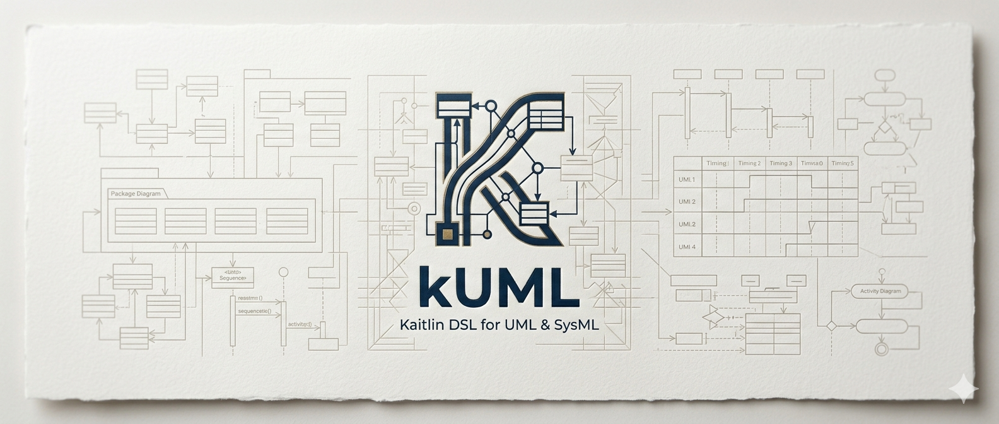
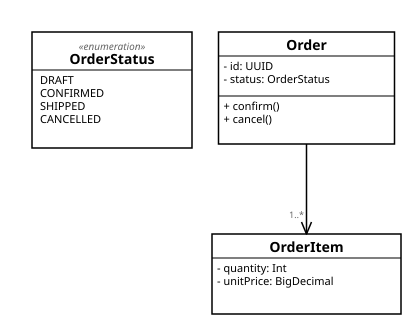

= kUML
:description: Architecture that compiles. One source. Any diagram. Readable for humans and AI.
:toc:
:toc-placement: preamble
:icons: font

[.lead]
*Architecture that compiles.* +
One source. Any diagram. Readable for humans and AI.

*Website:* https://kuml.dev · *Handbook:* https://docs.kuml.dev · *Releases:* https://github.com/kuml-dev/kUML/releases

*kUML* is a modelling tool that expresses UML 2.x, SysML 2, C4, BPMN 2.0 and ERM as a
type-safe Kotlin DSL — the first UML tool deliberately designed for the LLM era.

image:https://img.shields.io/maven-central/v/dev.kuml/kuml-core-dsl[Maven Central,link=https://central.sonatype.com/artifact/dev.kuml/kuml-core-dsl]
image:https://img.shields.io/jetbrains/plugin/v/dev.kuml.ide?label=JetBrains%20Plugin&logo=intellijidea[JetBrains Marketplace,link=https://plugins.jetbrains.com/plugin/dev.kuml.ide]
image:https://img.shields.io/github/actions/workflow/status/kuml-dev/kUML/ci.yml?branch=master&label=CI&logo=github[CI,link=https://github.com/kuml-dev/kUML/actions/workflows/ci.yml]
image:https://img.shields.io/github/actions/workflow/status/kuml-dev/kUML/codeql.yml?branch=master&label=CodeQL&logo=github[CodeQL,link=https://github.com/kuml-dev/kUML/actions/workflows/codeql.yml]
image:https://img.shields.io/badge/Kotlin-2.4-7F52FF.svg?logo=kotlin&logoColor=white[Kotlin 2.4,link=https://kotlinlang.org]
image:https://img.shields.io/badge/JDK-21+-ED8B00.svg?logo=openjdk&logoColor=white[Java 21+,link=https://adoptium.net]
image:https://img.shields.io/github/license/kuml-dev/kUML[Apache 2.0,link=https://github.com/kuml-dev/kUML/blob/master/LICENSE]

== Why kUML?

[.lead]
*Modeling deserves a compiler.*

Every feature in kUML exists in _some_ tool on the market. The specific combination does not exist anywhere else: *type-safe Kotlin DSL · UML 2.x + SysML 2 + C4 + BPMN 2.0 + ERM as first-class peers · executable behaviour runtime · LLM-first design · Apache 2.0.*

Existing UML tools fall into two categories:

* *Graphical CASE tools* (Enterprise Architect, MagicDraw) — proper modelling, but expensive and not Git-friendly.
* *Text-based diagram tools* (PlantUML, Mermaid) — versionable, but drawing tools only with weak UML support.

kUML closes this gap: a real modelling tool, expressed as Kotlin source code, fully versionable in Git, and built from the ground up for LLM-assisted workflows.

=== The two empty spaces nobody is filling

There are dozens of UML, SysML and architecture tools. None of them fill these two quadrants:

. *No serious modelling tool runs on a typed host language.* There are Python diagram libraries, Java APIs around EMF, custom text grammars by the dozen. There is no mature tool that treats the model as ordinary code in a modern, statically-typed language with IDE refactoring, compile-time checking, and natural build-system integration. kUML uses Kotlin's type-safe builders because they are the cleanest fit available — the principle, not the language choice, is the point.
. *No tool is designed for the LLM era.* PlantUML and Mermaid happen to be LLM-friendly because they have enormous training footprints. That is luck, not design. kUML is built for AI-assisted modelling on purpose: type-safe output that compiles or fails fast, consistent named parameters, an MCP server for agent introspection, a `kuml ai` subcommand, and a benchmark that measures how often LLM-generated models actually validate.

== Quick Start

[source,kotlin]
----
// order-domain.kuml.kts — no imports needed, kUML scripting host provides them
classDiagram(name = "Order Domain") {
    val status = enumOf(name = "OrderStatus") {
        literal(name = "DRAFT")
        literal(name = "CONFIRMED")
        literal(name = "SHIPPED")
        literal(name = "CANCELLED")
    }

    val order = classOf(name = "Order") {
        attribute(name = "id", type = "UUID")
        attribute(name = "status", type = status)        // enum val used as attribute type
        operation(name = "confirm")
        operation(name = "cancel")
    }

    val orderItem = classOf(name = "OrderItem") {
        attribute(name = "quantity", type = "Int")
        attribute(name = "unitPrice", type = "BigDecimal")
    }

    association(source = order, target = orderItem) {
        aggregation = AggregationKind.COMPOSITE
        source { multiplicity(spec = "1") }
        target { multiplicity(spec = "1..*"); role = "items" }
    }
}
----

[source,bash]
----
kuml render order-domain.kuml.kts --format svg
----

That command produces the diagram below — rendered straight from the script above
with ELK Sugiyama layout and the kUML theme:

== Animated Diagrams

kUML renders *pure SMIL SVG animations* directly from execution traces — no JavaScript, no GIF conversion.
Pass `--animated` on the CLI (or use a `kuml-animated` code block in Obsidian) and supply a
`kuml.trace.v1` JSON trace. Any browser that supports SVG SMIL plays them inline.

For sharing outside the browser, animated SVGs can also be exported to *Animated PNG*
(`--format=apng`, no external dependency), *Animated WebP* (`--format=webp`, requires
`img2webp` or `ffmpeg` on PATH), or *MP4* (`--format=mp4`, requires `ffmpeg` on PATH, encoded
as H.264/yuv420p). MP4 does not support a transparent background — use APNG or WebP instead
when transparency is required.

=== UML Sequence — message-dot animation

An animated `sequenceDiagram` (Place Order happy path). A blue dot glides along each arrow in
declaration order: `submitOrder()` → `POST /orders` → `INSERT order` → `ok` → `201 Created` → confirmation.
Rendered by `SequenceSmilRenderer`.

=== UML State Machine — state-highlighting animation

An animated `stateDiagram` (Traffic Light, two full cycles). The active state highlights in amber;
all others remain passive. Rendered by `StmSmilRenderer`.

=== BPMN Process — token animation

An animated `bpmnModel` (PdV membership application). A token travels along BPMN sequence
flows and a stroke-width pulse highlights each active task. Rendered by `BpmnSmilRenderer`.

== Installation

[cols="1,3"]
|===
| Method | Command / Link

| *Homebrew* (macOS/Linux)
| `brew install kuml-dev/kuml/kuml`

| *Homebrew Cask* (macOS desktop app)
| `brew install --cask kuml-dev/kuml/kuml-desktop`

| *Chocolatey* (Windows)
| `choco install kuml` — bundles a Java 21 runtime, no JDK needed.

| *Docker*
| `docker pull ghcr.io/kuml-dev/kuml-cli:<version>` — minimal CLI image.

| *Native installers and runtime bundles*
| DMG, MSI, DEB, RPM and self-contained ZIPs on the https://github.com/kuml-dev/kUML/releases[GitHub Releases] page.

| *Maven Central* (library modules)
| `implementation("dev.kuml:kuml-core-dsl:<version>")` — use the version shown in the badge above.
|===

SDKMAN! is built but not live yet (vendor onboarding is pending). The full guide, including the Gradle
plugin, the JetBrains plugin, the VS Code extension and building from source, is in
link:docs/handbook/modules/ROOT/pages/install.adoc[Installation].

== What is in the box

* *One DSL, five notations.* UML 2.x, SysML 2, C4, BPMN 2.0 and ERM are first-class peers, plus user journey maps and service blueprints.
* *Real metamodel.* A pure-Kotlin sealed hierarchy, no EMF in the core; XMI interop is an optional module.
* *OCL and typed expressions.* Constraints are evaluated directly on the model, `kuml validate --strict` type-checks guards and effects.
* *Executable behaviour.* Simulate and run state machines, activities and BPMN processes (`kuml simulate`, `kuml run`), with snapshot/restore and OTLP trace export.
* *Model-driven architecture.* M2M transformers and code generators for Kotlin, Java/JPA, SQL, Exposed, OpenAPI, Kubernetes and Docker; reverse engineering from Java, Kotlin and SQL.
* *Built for the LLM era.* Named parameters, a canonical formatter, structured diagnostics, an MCP server and a `kuml ai` toolbox with a benchmark.
* *Where you work.* CLI, Gradle plugin, JetBrains plugin, VS Code extension, a Compose Desktop app, a browser editor (`kuml serve`), Markdown (also via a link:tools/pandoc/README.adoc[Pandoc filter]), AsciiDoc/Antora and Obsidian (https://github.com/kuml-dev/obsidian-kuml[obsidian-kuml]).
* *Chain-backed models.* Connect behaviour models to EVM, CosmWasm, ink! and Move contracts (see link:docs/handbook/modules/ROOT/pages/chain-adapters.adoc[Chain Adapters]).
* *Interop.* Structurizr DSL, XMI, AUTOSAR ARXML and BPMN XML in and out; five built-in UML profiles (AUTOSAR, JavaEE, Spring, OpenAPI, SoaML).
* *Extensible.* A signed plugin system for themes, renderers, layout engines, generators and reverse engines.

== Supported notations

[cols="2,1,3"]
|===
| Notation | Diagram types | Reference

| *UML 2.x*
| 14
| link:docs/handbook/modules/reference/pages/uml-dsl.adoc[UML DSL]

| *SysML 2*
| 8
| link:docs/handbook/modules/reference/pages/sysml2.adoc[SysML 2 DSL]

| *C4*
| 6
| link:docs/handbook/modules/reference/pages/c4-dsl.adoc[C4 DSL]

| *BPMN 2.0*
| process, collaboration, choreography, conversation
| link:docs/handbook/modules/reference/pages/bpmn-dsl.adoc[BPMN DSL]

| *ERM*
| 4 notations (Martin, Bachman, Chen, IDEF1X)
| link:docs/handbook/modules/reference/pages/erm-dsl.adoc[ERM DSL]

| *Service blueprint*
| user journey maps
| link:docs/handbook/modules/ROOT/pages/user-journey.adoc[User Journey Maps]
|===

How kUML compares with PlantUML, Mermaid, D2, Structurizr and the big CASE tools, including where
those tools are the better choice, is in link:docs/handbook/modules/ROOT/pages/comparison.adoc[How kUML compares].
A shorter table is on https://kuml.dev/comparison[kuml.dev/comparison].

== Essential commands

[source,bash]
----
kuml render model.kuml.kts            # SVG (also --format png|latex)
kuml watch model.kuml.kts             # re-render on every save
kuml validate model.kuml.kts          # OCL constraints (add --strict for typed expressions)
kuml fmt model.kuml.kts               # canonical formatting (--check for CI)
kuml generate --plugin kotlin ...     # code generation (kotlin, java, sql, exposed)
kuml simulate model.kuml.kts          # execute a state machine, activity or BPMN process
kuml reverse --lang kotlin ./src      # recover a class diagram from source
kuml serve                            # browser editor with live preview
----

All commands, options and exit codes: link:docs/handbook/modules/tooling/pages/cli.adoc[CLI reference].

== Documentation

* https://docs.kuml.dev[*Handbook*] — DSL reference, CLI, Gradle plugin, MDA, plugin API, and the
  link:docs/handbook/modules/ROOT/pages/architecture.adoc[module overview]. Built with Antora from
  `docs/handbook/` on every push to `master`.
* https://kuml.dev[*Website*] — playground, release notes, feature overview, comparison.
* link:CHANGELOG.md[Changelog] and link:ROADMAP.adoc[Roadmap].
* link:docs/getting-started.adoc[Getting Started] and link:docs/diagram-types.adoc[Diagram-Type Reference].
* link:docs/benchmark/README.adoc[LLM Benchmark Guide].
* link:docs/release.md[Release & Distribution].

== Contributing

Issues and pull requests are welcome on https://github.com/kuml-dev/kUML/issues[GitHub]. Building from
source needs JDK 21 and, for the `kuml-web` frontend, Node.js `^20.19` or `>=22.12` with npm
(`./gradlew clean check`). Release binaries, Homebrew, Chocolatey and the Maven artifacts do not need Node.

== License

Apache 2.0 — see link:LICENSE[LICENSE]
